# Sestia — Ekran tasarımları v1

23 Eylül 2026 · Tasarım önerisi / onaylanmış uygulama değildir.

## Kapsam

Referanslardaki sıcak krem, doğal ışık, ahşap, kumaş, serif başlıklar ve kahverengi butonlar 18 ayrı ekran/durum görseline taşındı. Yerleşik ImageGen kullanıldı. Uygulama kodu değiştirilmedi, Anthropic test çağrısı veya deploy yapılmadı; gerçek kullanıcı verisi okunmadı. Başlangıçtaki karşılama ve isim ekranı referansları korunmuştur; bu sette diğer ekranlar geliştirilmiştir.

## Nasıl okunmalı?

Bunlar raster tasarım mockup'larıdır; çalışan arayüz veya onaylanmış ürün akışı değildir. Deniz, oda fotoğrafları, konuşmalar ve istatistikler örnektir. Güncel kaynaklar: app/page.js, app/globals.css, app/hosgeldin/page.js, app/giris/page.js, app/error.js, app/admin/page.js, app/admin-giris/page.js ve components/FeedbackButton.js. Karakter belgesi v1 ile faz-1 uygulama belgesi birlikte incelendi; hedef ile uygulanmış özellik ayrıldı.

Ana sayfada sohbet girişi, ayrı sohbet sayfası ve sohbet içinde görsel fikir sunumu tasarım önerileridir; uygulamada tamamlanmış işlevler olarak kabul edilmemelidir. Oda analiz geçmişiyle kalıcı serbest sohbet hafızası aynı şey değildir. Mevcut karar seçenekleri yalnızca ilgili değerlendirme ekranlarında korunmuştur; uygulamanın genel giriş kapısı yapılmamıştır.

## İnceleme notları

- Mobil ekranlar ilk görsel yön çalışmasıdır; küçük ekran, klavye, kaydırma, boş/yükleniyor/hata durumları ayrıca prototipte doğrulanmalıdır. Bu çalışma her durumun etkileşim tasarımını tamamlamaz.
- AI görsellerindeki ikon/logo, ok, kitap yazısı, ek açıklama ve örnek fotoğraflar nihai tasarım sistemi değildir. Özellikle yönetici girişinde üretilen yaprak işareti yeni logo kararı değildir; uygulamada mevcut onaylı işaret korunmalıdır.
- Nesne fotoğrafları ekranlar arasında aynı fiziksel eşyanın doğrulanmış devamlılığını temsil etmez. Gerçek uygulamada aynı eşya için aynı fotoğraf/kayıt kullanılmalı.
- Oda listesindeki fotoğraf/analiz sayıları, analiz başlıkları ve bazı kart okları yeni görsel sunum önerileridir; veri/API ve etkileşim karşılıkları uygulama öncesi kontrol edilmelidir.
- Üretilen görsellerdeki dekoratif metinler veya yeni bağlantılar onaylı ürün metni/özelliği sayılmaz. Tasarımdan koda geçerken gerçek metin, erişilebilir kontrast, alan etiketleri ve dokunma boyutları ayrı uygulanmalıdır.

## Ekran listesi

| # | Ekran | Mevcut karşılığı / öneri |
|---|---|---|
| 1 | [Keşif / ilk kullanım](01-kesif.png) | KesifView |
| 2 | [Ana sayfa / geri dönen kullanıcı](02-ana-sayfa.png) | HomeView — sohbet girişi yeni düzen önerisi |
| 3 | [Sestia ile sohbet](03-sohbet.png) | KesifView sohbeti — ayrı ekran ve görsel fikir kartı önerisi |
| 4 | [Hesap / giriş yöntemi](04-hesap.png) | WelcomeView / account |
| 5 | [Odalarım](05-odalarim.png) | RoomsListView |
| 6 | [Oda detayı](06-oda-detay.png) | RoomDetailView |
| 7 | [Tek fotoğraf ekleme](07-fotograf.png) | ScanView |
| 8 | [Oda fotoğrafları](08-oda-fotograflari.png) | RoomScanView |
| 9 | [Eşya değerlendirmesi](09-esya-degerlendirme.png) | DecisionView |
| 10 | [Oda değerlendirmesi](10-oda-degerlendirme.png) | RoomReviewView |
| 11 | [Geçmiş analiz / salt okunur](11-analiz-gecmisi.png) | room-analysis / RoomReviewView salt okunur |
| 12 | [Haftalık ilham](12-ilham.png) | InspirationView |
| 13 | [Karar kaydedildi](13-tamamlandi.png) | CelebrationView |
| 14 | [Davet kodu / erişim](14-erisim.png) | /giris |
| 15 | [Geri bildirim paneli](15-geri-bildirim.png) | FeedbackButton paneli |
| 16 | [Hata / yeniden deneme](16-hata.png) | /error |
| 17 | [Yönetici girişi](17-yonetici-giris.png) | /admin-giris |
| 18 | [Yönetici paneli](18-yonetici-paneli.png) | /admin |

## Görsel galeri

### Keşif / ilk kullanım

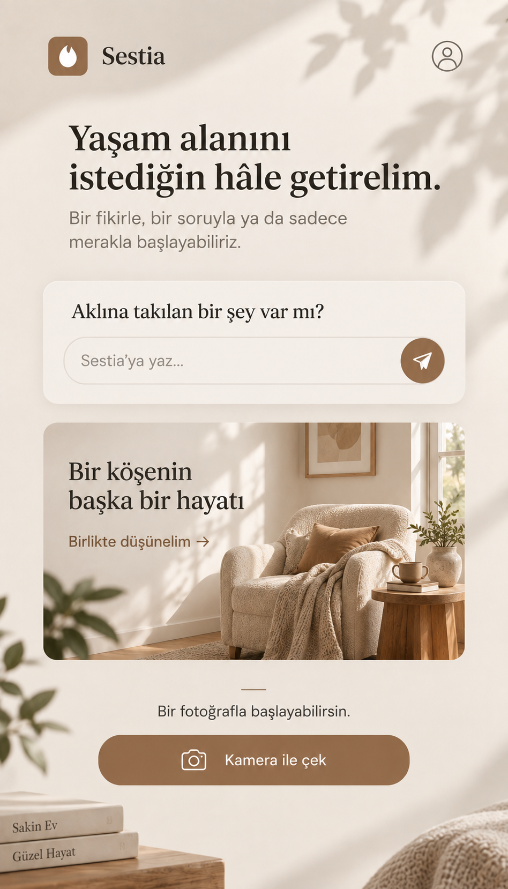

### Ana sayfa / geri dönen kullanıcı

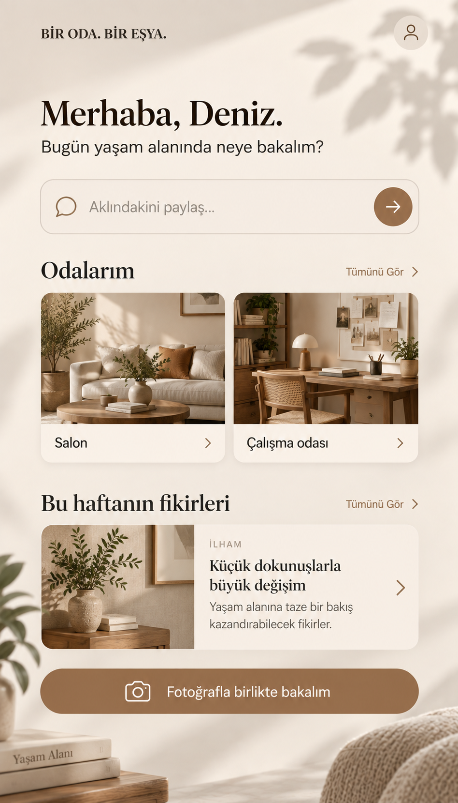

### Sestia ile sohbet

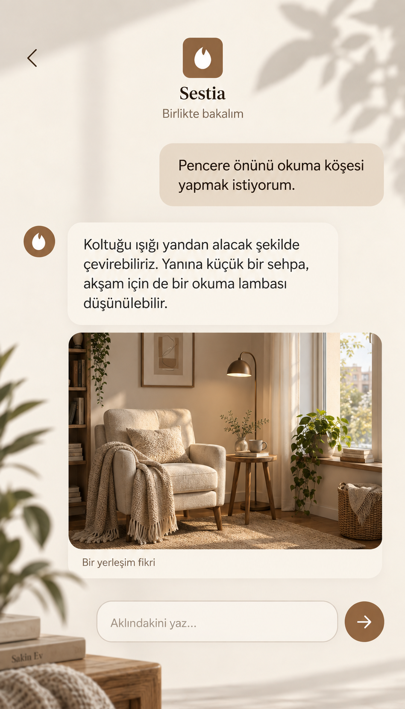

### Hesap / giriş yöntemi

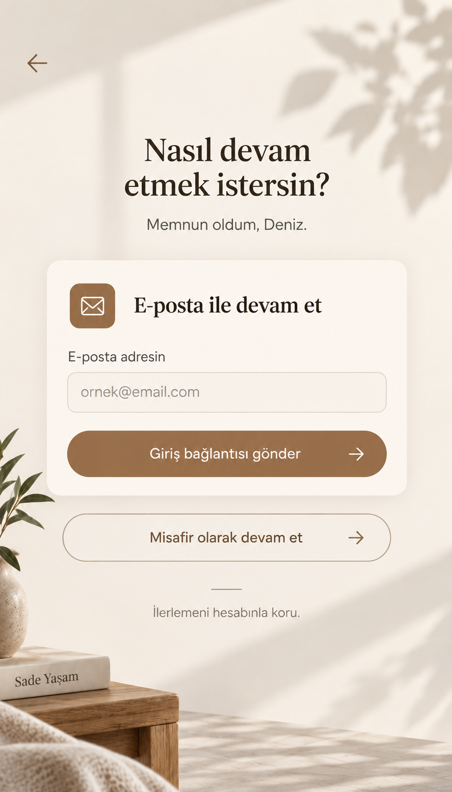

### Odalarım

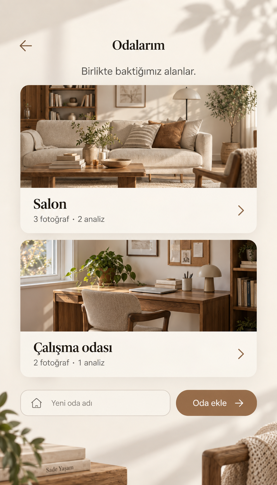

### Oda detayı

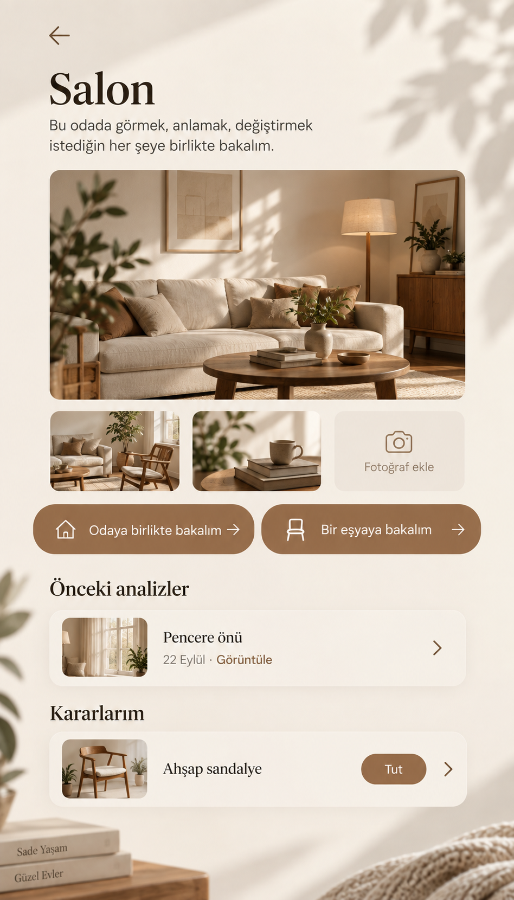

### Tek fotoğraf ekleme

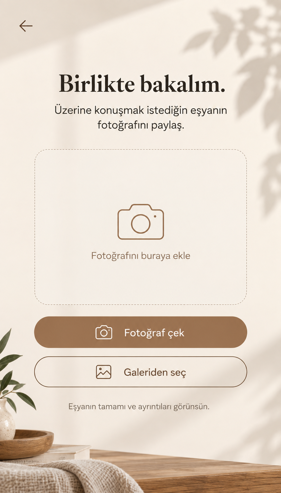

### Oda fotoğrafları

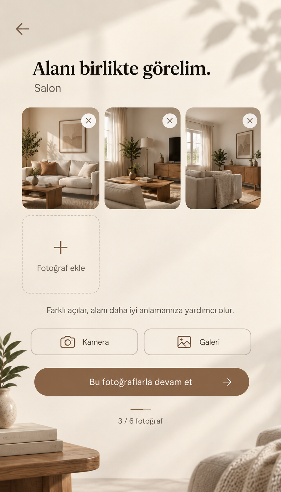

### Eşya değerlendirmesi

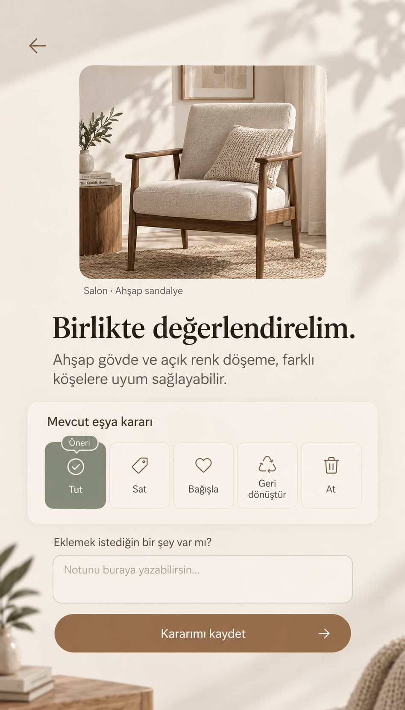

### Oda değerlendirmesi

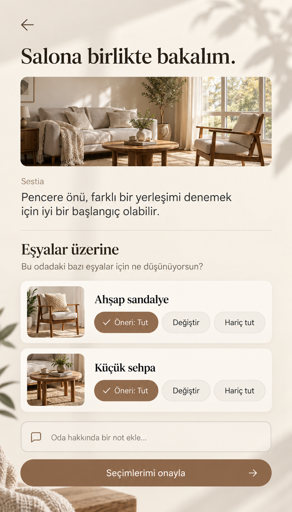

### Geçmiş analiz / salt okunur

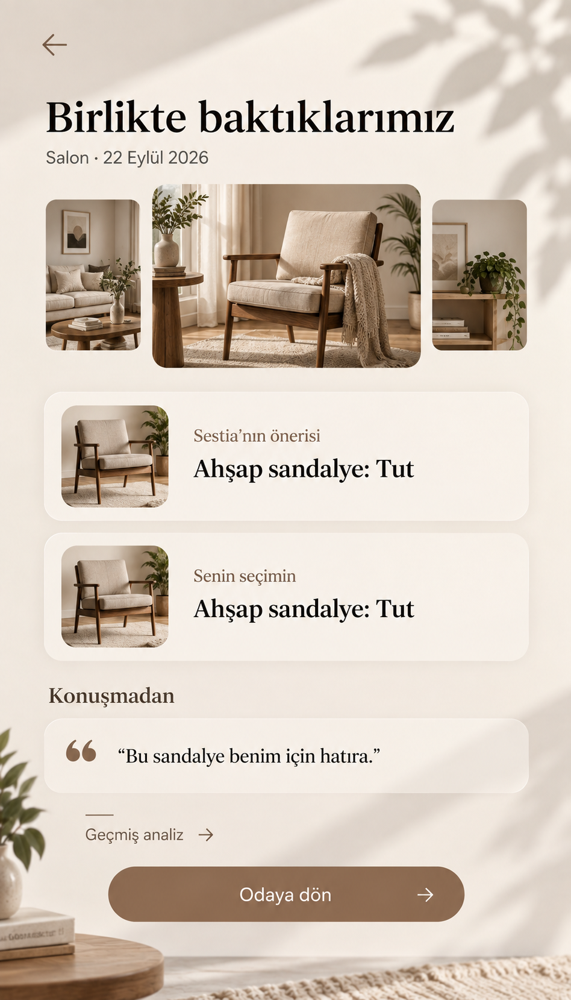

### Haftalık ilham

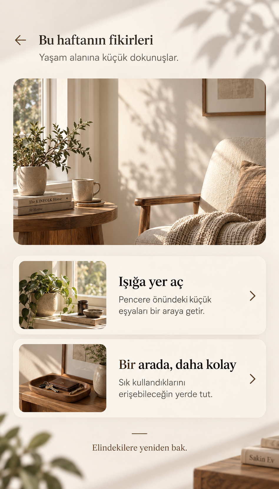

### Karar kaydedildi

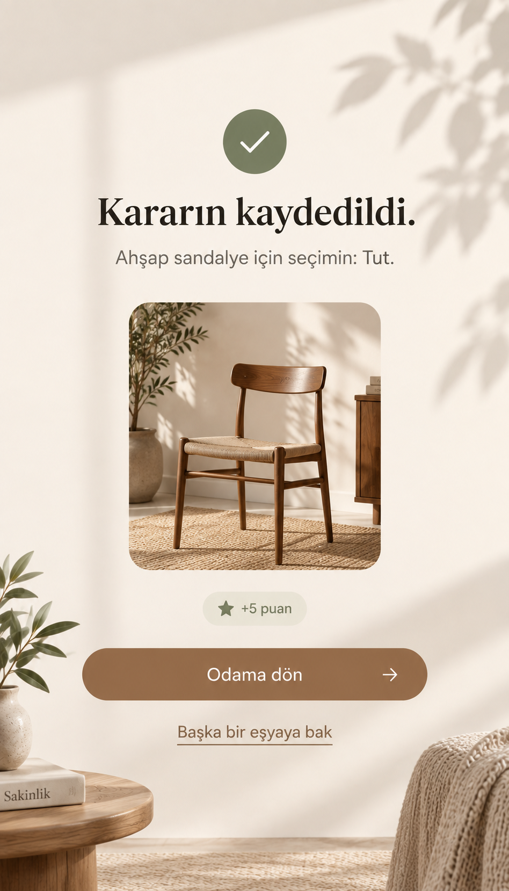

### Davet kodu / erişim

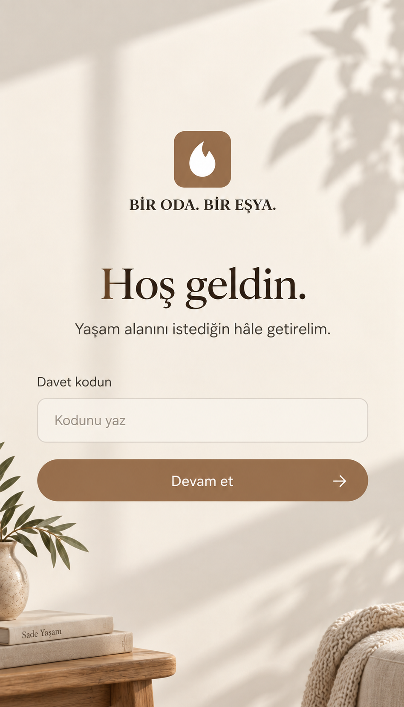

### Geri bildirim paneli

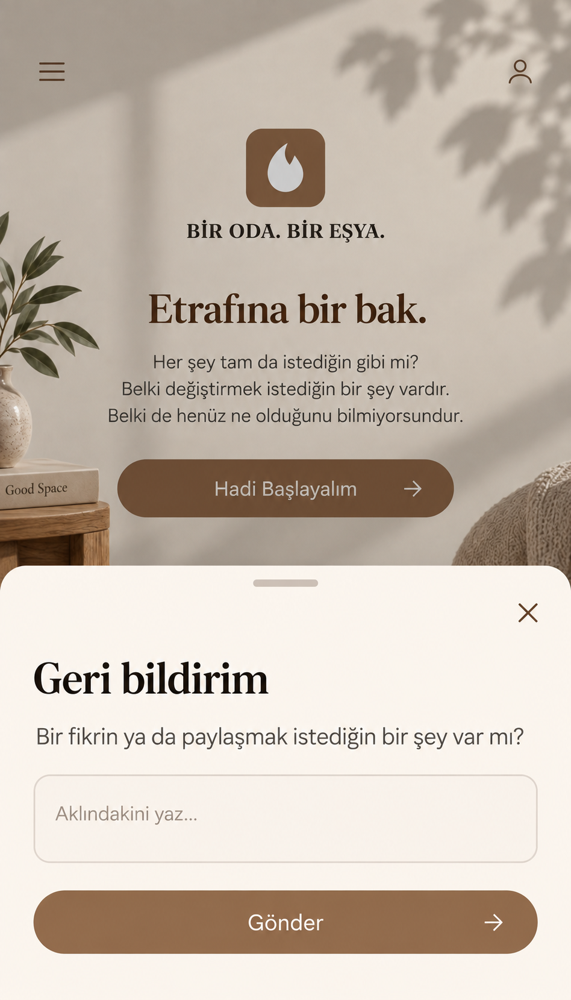

### Hata / yeniden deneme

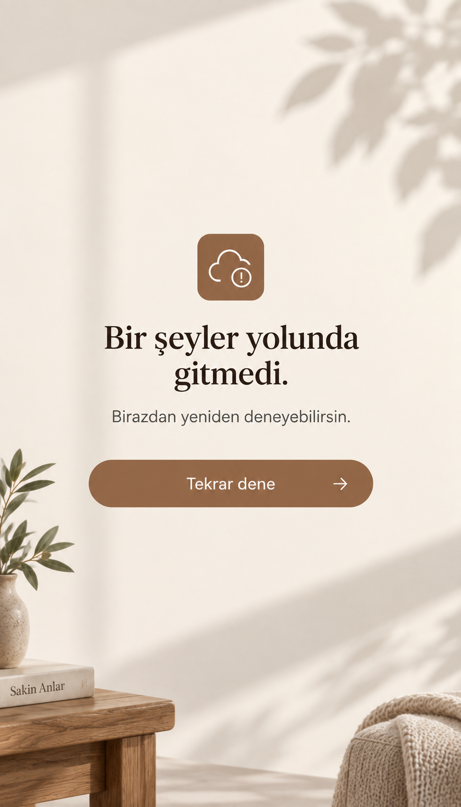

### Yönetici girişi

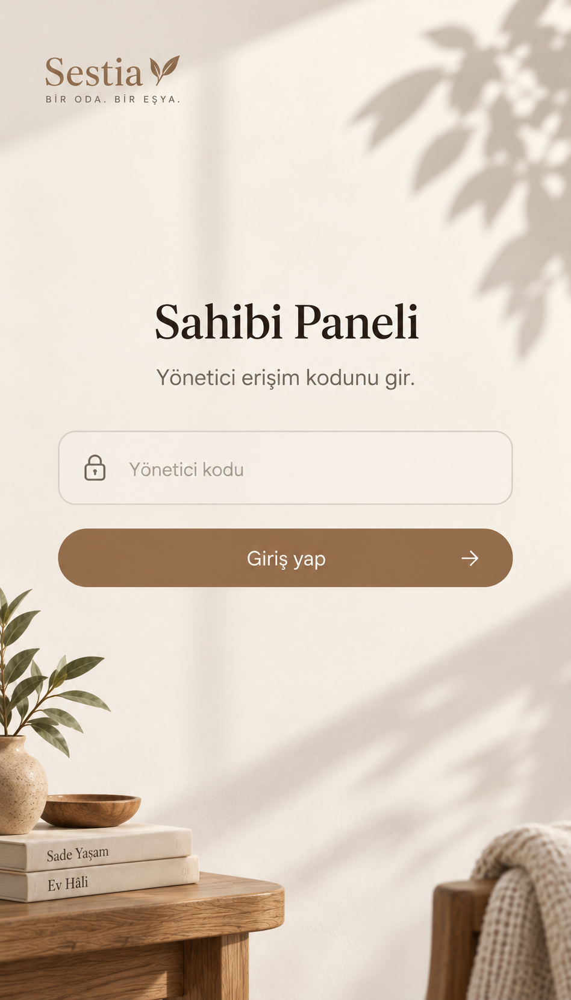

### Yönetici paneli

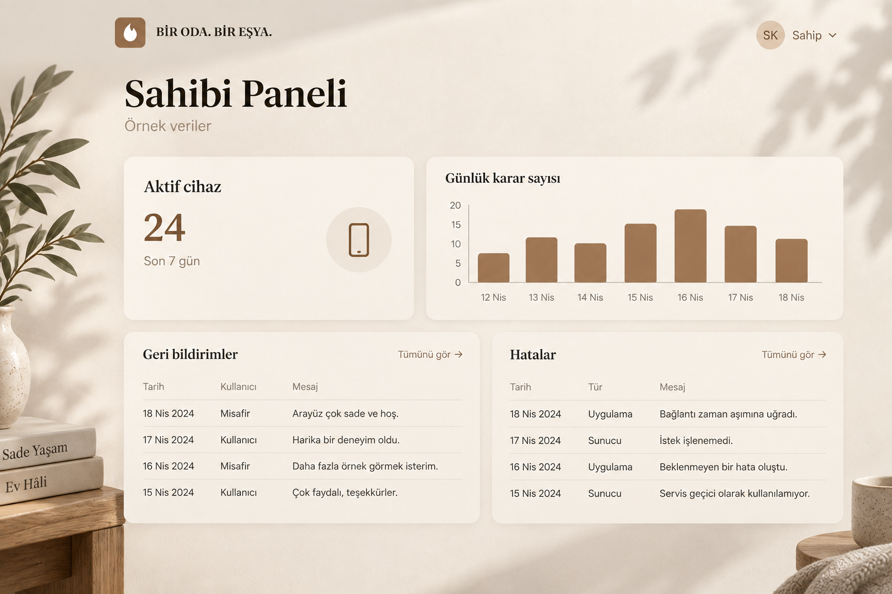

